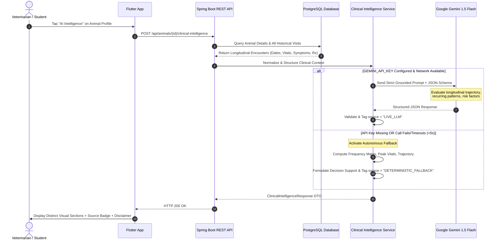

# VetLedger AI — Clinical Intelligence Architecture & Grounding Strategy

## 1. Problem Statement: Why Veterinary LLMs Fail Without Grounding

In livestock veterinary care, unstructured large language models suffer from three fatal flaws if used naively:
1. **Hallucination of Clinical History**: An LLM given an ungrounded prompt will invent prior antibiotic treatments, assume non-existent comorbidities, or fabricate historical lab values.
2. **Autonomous Prescribing Hazards**: Generating specific prescription dosages or claiming definitive diagnoses without physical palpation and auscultation violates veterinary regulatory frameworks.
3. **Connectivity Fragility**: Rural clinics often operate with unstable cellular connectivity. An application that crashes when an LLM API is unreachable is unusable in the field.

VetLedger AI solves this with **Record-Grounded RAG Formulation**, **Strict Output Schematization**, and an **Autonomous Deterministic Clinical Fallback Engine**.

---

## 2. The Clinical Intelligence Pipeline



---

## 3. Strict Prompt Grounding & Output Contract

When calling Gemini, VetLedger AI enforces rigorous constraints:

```text
You are a specialized veterinary clinical intelligence system providing decision support for licensed veterinarians.
GROUNDING RULES:
- Ground all analysis strictly in the provided animal records.
- Do not invent symptoms, lab values, or dates.
- Do NOT prescribe medications or make definitive diagnostic claims.
- Frame conditions as 'Differential Considerations' for veterinary review.
```

### Response Schema:
```json
{
  "animalId": 1,
  "animalCode": "COW-SNG-101",
  "animalName": "Lakshmi",
  "source": "LIVE_LLM" | "DETERMINISTIC_FALLBACK",
  "modelName": "gemini-1.5-flash",
  "clinicalSummary": "Comprehensive multi-encounter summary grounded in record dates and presenting complaints...",
  "historicalFindings": [
    "Longitudinal span: 3 encounters over 2026-06-12 to 2026-10-22",
    "Peak recorded body temperature: 40.4°C (febrile episode)"
  ],
  "recurringSymptoms": [
    "Reduced Appetite (detected in 2 of 3 visits)",
    "Fever (detected in 2 of 3 visits)"
  ],
  "symptomChangesOverTime": "Acute onset: Transitioned from routine mild off-feed to acute febrile respiratory presentation on 2026-10-22.",
  "riskIndicators": [
    "Hyperthermia: High rectal temperature (40.4°C) indicates active systemic response.",
    "Synergistic respiratory & metabolic stress: Co-occurrence of anorexia and nasal exudate."
  ],
  "possibleConditionsToConsider": [
    "Bovine Respiratory Disease Complex (BRDC) / Enzootic Pneumonia spectrum",
    "Early Hemorrhagic Septicemia (HS) prodromal phase"
  ],
  "recommendedObservations": [
    "Auscultate lungs twice daily for abnormal bronchial rales or wheezes.",
    "Measure rectal temperature every 12 hours before morning and evening feeding.",
    "Assess hydration status via skin tent elasticity."
  ],
  "suggestedFollowUp": "Isolate the animal in a well-ventilated dry stall. Re-evaluate within 24 to 48 hours.",
  "veterinaryReviewRecommendation": "Decision-Support Output: Final clinical diagnosis and drug selection remain the sole responsibility of the attending registered veterinarian.",
  "disclaimer": "AI-generated clinical decision support. Final assessment remains with a qualified veterinarian."
}
```

---

## 4. Deterministic Clinical Fallback Engine

When no API key is provided, or in offline conditions:
1. **Never Fakes an LLM Call**: The UI displays an amber badge `DETERMINISTIC FALLBACK ENGINE`.
2. **Real Record Synthesis**:
   - Calculates total historical visits, first and latest encounter dates.
   - Computes symptom frequency across all visits (identifies true recurring symptoms).
   - Detects longitudinal trajectory:
     - *Acute onset*: Mild previous history with severe recent presentation.
     - *Recurrent / Chronic*: Multiple severe episodes across history.
     - *Sub-acute / Stable*: Mild-to-moderate historical episodes.
   - Extracts peak temperature to trigger hyperthermia risk flags.
   - Formulates explainable differential considerations based on symptom co-occurrence (e.g. fever + nasal discharge -> BRDC / Enzootic Pneumonia differential).
   - Generates tailored monitoring checklists (lung auscultation, rumen motility, hydration).

---

## 5. Decision Support Boundaries & Safety

* **Non-Prescriptive**: Does not generate dosage calculations or drug sales links.
* **Differential, Not Diagnostic**: Uses phrases such as *"Differential conditions to consider for veterinary evaluation"*.
* **Auditable Evidence**: Every finding cites specific dates, complaints, or symptom occurrences from the database.
