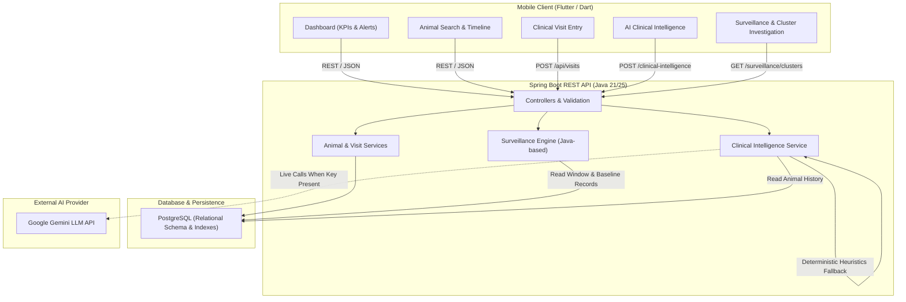

# VetLedger AI — System Architecture & Design Specification

## 1. Architectural Philosophy

**VetLedger AI** is engineered as a resilient, decoupled HealthTech decision-support platform designed specifically for rural livestock veterinary care and district-level disease surveillance.

The system addresses three critical operational gaps in animal healthcare:
1. **Fragmented Longitudinal Records**: Animal health events are historically recorded in isolation, preventing veterinarians from identifying chronic or evolving clinical patterns.
2. **Delayed Emerging Disease Recognition**: Symptom patterns spread across multiple smallholder farms and villages often escape manual observation until an outbreak has progressed.
3. **Connectivity & AI Fragility**: Rural clinics face intermittent internet connectivity and volatile LLM rate limits. VetLedger AI enforces a zero-dependency deterministic fallback engine to guarantee uninterrupted service.

---

## 2. Component Architecture

### 2.1 Mobile Application (`mobile/`)
* **Framework**: Flutter 3.47+ (Dart 3.13+)
* **Design System**: Material 3 HealthTech theme
* **Color Palette**:
  - Primary: Deep Teal (`#006A60`)
  - Primary Light: Soft Mint (`#E6F5F2`)
  - Accent / Monitoring: Emerald (`#0F766E`), Sage (`#2DD4BF`)
  - Alert / Priority: Crimson (`#DC2626`), Amber (`#D97706`)
  - Surface: Neutral Slate (`#F8FAF9`, `#FFFFFF`)
* **State & Networking**: REST API integration via `http` client with auto-detection of Android Emulator (`10.0.2.2`), Desktop/Web (`localhost`), or configurable LAN IP.
* **Core Screens**:
  1. `DashboardScreen`: System overview, key performance indicators, active alerts banner, quick clinical actions, recent visits timeline.
  2. `AnimalListScreen`: Full-text search by animal code, name, breed, or farm; village and species filter chips.
  3. `AnimalProfileScreen`: Complete longitudinal health profile, farm linkage, RFID tag, chronological encounter history with vitals and symptom tags.
  4. `VisitEntryScreen`: Rapid clinical exam entry form, standardized multi-symptom chip selectors, temperature input, severity classification, treatment and biosecurity notes.
  5. `ClinicalIntelligenceScreen`: Structured AI clinical decision-support screen with visual status badge (`LIVE LLM` vs `DETERMINISTIC FALLBACK`), recurring symptoms, longitudinal trajectory, risk indicators, differential considerations, recommended monitoring, and veterinary disclaimer.
  6. `SurveillanceDashboardScreen`: Real-time syndromic surveillance cluster cards, observation window filter, geographic coverage across monitored villages.
  7. `ClusterInvestigationScreen`: Drill-down cluster investigation showing why the cluster was detected, affected distinct animals (with direct profile navigation), affected farms, baseline comparison metrics, and recommended field veterinary actions.

---

### 2.2 Backend Service (`backend/`)
* **Framework**: Spring Boot 3.3.5 / Java 21 LTS
* **Architecture**: Clean 4-tier layered architecture (Controller -> Service -> Repository -> Entity)
* **API Standards**: RESTful JSON with Bean Validation (`@Valid`, `@NotNull`, `@NotEmpty`), RFC 7807 compliant error handling via `@RestControllerAdvice`.
* **CORS**: Universally configured for seamless local mobile development, emulator testing, and desktop/web clients.

---

### 2.3 Database Layer (`database/`)
* **Engine**: PostgreSQL (Production) / In-Memory H2 (Testing)
* **Design**: Third-normal-form relational data model:
  - `villages`: Spatial centroids, administrative districts
  - `farms`: Registered livestock units mapped to villages
  - `animals`: Individual livestock records with longitudinal foreign keys
  - `visits`: Clinical encounters, vitals, observations, treatments
  - `visit_symptoms`: Normalized junction entity for flexible, index-accelerated symptom aggregation and clustering
* **Reproducibility**: Pre-seeded with 5 villages, 12 farms, 80 animals, 193+ visits, and 389+ normalized symptoms. Idempotent initialization via `DataSeederService` prevents duplicate records upon restart.

---

## 3. Security, Boundaries & Compliance

1. **Synthetic Isolation**:
   - The hackathon prototype resides strictly in `VetLedger-AI/`.
   - Never accesses or modifies any external production codebase or database.
   - All demonstration data is visibly and programmatically flagged as synthetic.
2. **Credential Management**:
   - API keys are injected exclusively via environment variables (`GEMINI_API_KEY`).
   - Secrets are never embedded in mobile code, git history, or client API responses.
   - Zero-key startup: The entire system functions fully out of the box using deterministic intelligence when no API key is provided.
3. **Veterinary Decision Support Disclaimers**:
   - The platform strictly produces advisory decision support.
   - Mandatory disclaimers are enforced across all AI responses and surveillance alerts: *"AI-generated clinical decision support. Final assessment remains with a qualified veterinarian."*
