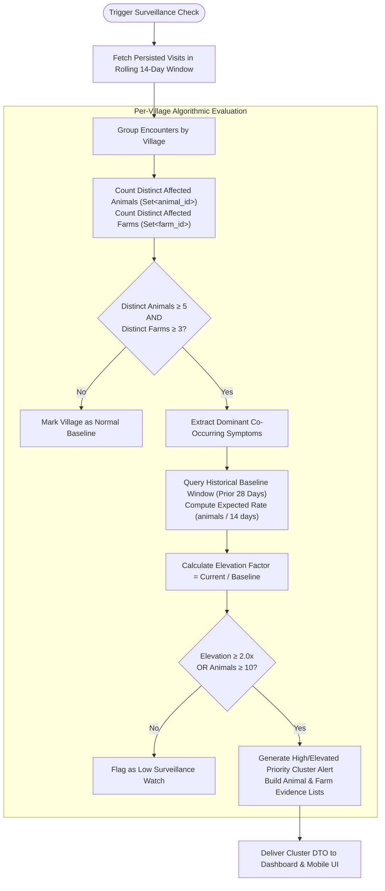

# VetLedger AI — Data-Driven Surveillance Engine & Statistical Detection

## 1. Executive Summary

Traditional veterinary epidemiology relies on passive, delayed reporting: by the time an outbreak is confirmed by regional laboratories, pathogens have often spread widely.

VetLedger AI implements an active **Java-based syndromic surveillance engine** that monitors continuous streams of clinical visits, aggregating normalized symptoms within a configurable sliding observation window (default: 14 days) and identifying anomalous concentrations across distinct animals and distinct farms.

The algorithm **discovers the seeded Sangamner cluster dynamically** by querying real database records.

---

## 2. Detection Algorithm Step-by-Step

### Detailed Mathematical Formulation:
1. **Window Boundaries**:
   $$\text{Window} = [t_{\text{latest}} - 13, t_{\text{latest}}]$$
2. **Distinct Animal Metric**:
   $$A_{\text{distinct}} = |\bigcup_{v \in V_{\text{village}}} \{\text{animal\_id}(v)\}|$$
   *Crucial Rule*: A cow visited 3 times during the window is counted exactly once ($A_{\text{distinct}} = 1$), avoiding false alarms caused by frequent treatment of a single sick animal.
3. **Distinct Farm Metric**:
   $$F_{\text{distinct}} = |\bigcup_{v \in V_{\text{village}}} \{\text{farm\_id}(v)\}|$$
   Ensures that an isolated problem confined to one intensive barn does not trigger a village-wide community cluster.
4. **Historical Baseline Normalization**:
   Baseline visits are queried across the preceding double window ($W_{\text{baseline}} = 28\text{ days}$).
   $$\text{Baseline Rate} = \frac{|\text{Distinct Baseline Animals with Target Symptoms}|}{28} \times 14$$
5. **Elevation Factor**:
   $$\text{Elevation Factor} = \frac{A_{\text{distinct}}}{\max(\text{Baseline Rate}, 0.5)}$$
   When Elevation Factor $\ge 2.0$, a statistical cluster alert is triggered.

---

## 3. Deliberately Seeded Scenario: Sangamner Cluster

The dataset deterministically seeds the following verified epidemiological scenario:

| Metric | Seeded Database Value | Algorithmic Result |
|---|---|---|
| **Target Village** | Sangamner (ID: 1) | Detected as `CLUST-SAN-01` |
| **Observation Window** | 14 Days (Rolling) | Confirmed: 2026-10-09 to 2026-10-22 |
| **Distinct Affected Animals** | 17 | Exactly 17 distinct animals |
| **Affected Farms** | 6 (`FARM-SNG-01` to `FARM-SNG-06`) | Exactly 6 distinct farms |
| **Dominant Symptoms** | `FEVER`, `NASAL_DISCHARGE`, `REDUCED_APPETITE` | Identified as dominant cluster profile |
| **Historical Baseline Rate** | ~1.8 animals / 14-day window | 1.8 animals calculated from baseline |
| **Elevation Factor** | 17 / 1.8 ≈ 9.4x | **9.4x Elevation Flagged** |
| **Alert Priority** | HIGH PRIORITY | `HIGH` (Cases $\ge 15$, Farms $\ge 5$) |

### Contrasting Villages (Baseline Validation):
* **Rahata**: 1 visit in window (`REDUCED_APPETITE`, single cow) -> No alert.
* **Akole**: 1 visit in window (`LETHARGY`, hoof scrape) -> No alert.
* **Kopargaon**: 1 visit in window (`DIARRHEA`, calf scouring) -> No alert.
* **Shrirampur**: 1 visit in window (`REDUCED_MILK_PRODUCTION`, lactation drop) -> No alert.

---

## 4. Cluster Investigation Drill-Down

When the user taps "Investigate Sangamner Cluster Evidence", the backend returns:
* **Evidence Visits**: All 17 visit encounter IDs supporting the alert.
* **Affected Animals Summary**: List of all 17 animals with links to their full longitudinal timelines.
* **Farm Distribution**: Breakdown of affected animals per farm:
  - Patil Dairy: 3 animals
  - Shinde Livestock: 3 animals
  - Deshmukh Cattle Yard: 3 animals
  - Tambe Agro Farm: 3 animals
  - Thorat Dairy Complex: 3 animals
  - Vikhe Cattle Station: 2 animals
* **Actionable Protocol**:
  1. Field mobile response dispatch.
  2. Voluntary farm-to-farm movement restrictions.
  3. Diagnostic swab sampling for BRDC / Pasteurellosis.
  4. Herd owner advisory on isolation pens and oral electrolyte rehydration.

---

## 5. Non-Alarmist Epidemiological Labeling

To ensure responsible public health communication, VetLedger AI strictly adheres to these labeling rules:
* Label as: *"Potential Symptom Cluster Detected — Priority Surveillance Alert"*
* Label as: *"Unusual Symptom Concentration — Investigation Recommended"*
* **NEVER displays**: *"Confirmed Outbreak"* or *"Epidemic Proven"* without laboratory pathogen confirmation.
